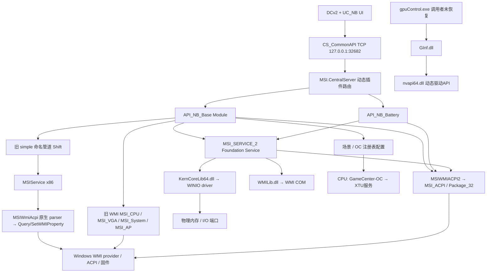

# GS66 Stealth 10SE：Dragon Center 静态逆向研究

研究日期：2026-10-11。目标为 MSI GS66 Stealth 10SE、Core i7-10750H、RTX 2060；实际 BIOS、EC 和 Windows 已装软件版本尚未知。本阶段只下载、解包、读取元数据和反编译，没有执行目标 Windows 程序、启动服务、加载驱动、连接硬件或进行任何硬件写入。下文出现的写入代码、地址和协议用于解释原厂实现，不是可执行操作指南。

## 结论与适用范围

原厂控制不是单一的“MSI SDK API”。本次安装包包含 UI、TCP 插件服务器、Foundation Service、旧 WMI/命名管道路径、WMI2 ACPI 路径及 WinIO 内核访问层。自定义风扇曲线确实从 UI 到达后台写入函数；旧路径操作 `MSI_CPU`、`MSI_VGA` 的 WMI 实例，新路径使用 `Get_Fan/Set_Fan`。电池上限及 Cooler Boost 的旧路径则经 `MSI_SERVICE_2`、`KernCoreLib64.dll` 和 `WINIO` 驱动访问物理内存。不能据此承诺 GS66 可以完全用 WMI2、无需 MSI 服务或内核访问。[B02–B08]

界面和后台呈现 CPU/GPU 两组、每组六个可调速度值，后台返回两个 RPM 值；官方配置中的 GS66 10SE 风扇数是三。两组逻辑控制路径已由二进制证实，三颗实体风扇如何映射到这两组仍未知。原厂有曲线功能，不等于已经恢复 GS66 G1 的原始 EC 曲线表地址。[B03、B04、B09]

性能场景会联动 Shift 状态、风扇和部分 Windows 电源计划。已恢复 CPU/GPU OC 的配置与访问入口，但尚不能证明 GS66 的场景切换直接设置 PL1/PL2，或 RTX 2060 的 TGP。目标 CPU 不满足本次 Base Module 的 CPU OC 白名单。电池上限的 60/80/100 编码、低七位掩码与旧版 `0xFC0008EF` 路径已确认，固件是否持久保存、实际充电迟滞及停掉服务后的效果尚待实机验证。[B04–B06、B10]

全文证据等级：**[BIN]** 当前取得的原厂二进制中直接可见；**[SRC]** 固定提交的公开源码/文档支持；**[INF]** 基于代码和目标规格的推断；**[HW?]** 需要 GS66 Windows 实机验证。`[BIN]` 证明该版本包含某条代码路径，不代表目标机已走过该路径，更不代表硬件测试成功。证据编号在末尾索引；便于阅读的规范化片段保存在 [managed-excerpts.md](evidence/dragon-center/managed-excerpts.md)，逐字反编译截取、行号、样本及源文本哈希在 [managed-exact.json](evidence/dragon-center/managed-exact.json)，原生证据在 [native/](evidence/dragon-center/native/)。

## 1. 官方安装包、版本与解包

MSI [GS66 10SX 支持页](https://www.msi.com/Laptop/GS66-Stealth-10SX/support) 是包含 10SE 的系列入口；[规格页](https://www.msi.com/Laptop/GS66-Stealth-10SX/Specification) 列出对应 GPU。[MSI FAQ 3751](https://www.msi.com/faq/3751) 在 2020 年的说明中将 GS66 列为支持 UWP Dragon Center 的机型。本次优先采用 [MSI notebook Dragon Center 官方下载页](https://www.msi.com/Landing/dragon-center-download/nb) 给出的 [Dragon-Center.zip](https://download.msi.com/uti_exe/common/Dragon-Center.zip)，成功下载并通过 ZIP CRC 校验；其内唯一安装器为 `Dragon Center_2.0.158.0.exe`。[B01]

**取得的是当前官方通用包，并非已经确认的 2020 年出厂镜像。** 动态支持页未提供可核验的历史版本绑定；包内 `Fan.txt` 明确包含 GS66 10SE，但安装器内 SDK 版本甚至已为 2026 年。对当前包的分析可以恢复兼容路径，不能把所有组件版本倒推为 GS66 上最初预装版本。若要完成历史版本比对，最小额外输入是目标机已装文件的版本/SHA-256，或 MSI 官方归档的当年安装包；无需提供序列号、完整 WMI dump 或固件刷写文件。

| 层级 | 文件/声明 | SHA-256 或说明 |
| --- | --- | --- |
| 下载容器 | `Dragon-Center.zip` | `cbf1d93d8ee5fbdc09d544df63284dd1ed100c899a0d440af5c22cc192ec9133` |
| 外层安装器 | `Dragon Center_2.0.158.0.exe`；471,350,624 bytes；Inno Setup 5.4.2 Unicode | `f91ca53ff5f6434a24529aa13ed3ddf8eb5de41064313ee84948587cbbd8b113` |
| UI 清单 | `AppxManifest.xml` 声明 `2.0.153.0`；FullTrustApp=`DCv2/DCv2.exe` | 清单版本与外层安装器不同，见 UI inventory |
| UI 可执行文件 | `DCv2.exe` FileVersion=`2.0.156.0` | `b60811864bff3edf344660b424d21cf86a62347b75a2eabba85326aebbdf07ce` |
| 内层 SDK 安装器 | `app/DCv2/Package/MSI SDK.exe`；`2.2026.0821.01`；Inno | `e6013ef092978a8f635be03a270d05662436adf415a8720c226d9fd3a378b7aa` |
| NBFoundation 包装器 | `tmp/PrePackage/MSI_NBFoundation_Service.exe`；`1.0.2411.1201`；托管 EXE | `5c52905c8b349b9883c84351e2fdcfb45ad49d264a03f731b0ea2c4ca83276c0`；不是 Inno 安装器 |
| 实际 Foundation 安装器 | `tmp/PrePackage/Export/Setup.exe`；`1.0.2411.1201`；Inno | `54860b1481f0b64e63629bef93f85a16884d625910fdd2b14bc946e0b565f3b8` |

离线解包顺序是 ZIP → 外层 Inno → 内嵌 `MSI SDK.exe` → SDK 内的 `Export/Setup.exe`。没有用 Wine、Windows 沙箱或安装器运行来获取文件。三层 inventory 各有 184、29、160 个文件，共 373 个文件记录，其中 124 个托管 PE、80 个原生 PE、169 个配置/数据文件，解析错误为 0；这是三个独立提取树的记录，包含内层容器与其展开结果，不能解释为 373 个安装后独立组件。

完整文件名、字节大小、FileVersion、SHA-256、PE Machine、CLR 标志、程序集版本、AssemblyRef、原生 imports/exports 见 [binary-index.md](evidence/dragon-center/binary-index.md) 及 [UI inventory](evidence/dragon-center/inventory-ui.json)、[SDK inventory](evidence/dragon-center/inventory-sdk.json)、[Foundation inventory](evidence/dragon-center/inventory-nbfoundation.json)。非 PE 配置也有哈希；缺失的版本资源保留缺失，不推测版本。[config-excerpts.json](evidence/dragon-center/config-excerpts.json) 保存 AppxManifest 与 DCv2.exe.config 原文：实际启动为 FullTrust desktop 应用，runtime 声明 .NET Framework 4.8，配置默认启用 bStartup/bAlways_Update。Appx 的 DesktopBridge 构建元数据不等于实际程序为纯 UWP/.NET Core；自动更新默认也意味着安装后样本可能变化。

## 2. 分析方法与关键组件

使用了 `morluto/rea` 的 `reverse-engineer-anything` Skill v34（`rea-agents` 6.3.0）及真实 REA stdio MCP。桌面会话没有暴露预注册的 REA 工具，因此在隔离 Node 24.21.0 下连接已取得的 REA 包，调用 `inspect_artifact`、`inspect_managed_artifact`、`inspect_managed_members`、`inspect_managed_native_boundaries`；原生分析调用 `open_binary(provider_id="ghidra")` 和 `analyze_function`。REA 的完整工具结果较大，托管成员证据按研究范围筛选，保留原 `source_evidence_id`、原结果哈希、artifact SHA、MVID、method token、RVA、IL hash/anchor，不把筛选副本伪装成完整原始结果。[B01、B11]

托管控制流由 ILSpy 11.1.0.9782 的 `ICSharpCode.Decompiler` 离线解码；原生 DLL/SYS 使用 Ghidra 12.1.4 + Temurin 21.0.12.1。macOS arm64 的 Ghidra 包缺少原生 decompiler，已从同版本随包 C++ 源码在隔离目录构建后继续分析。没有加载目标程序集执行代码；缺失 Windows Framework 引用导致部分 ILSpy 文本含 `Unknown result type` 注释，相关结论结合 REA IL 调用和常量核对，未把这些注释当作目标文件损坏。

下表使用提取根标记：`U`=UI 外层，`S`=SDK，`N`=Foundation；完整哈希在上述清单及片段文件。文件同名或版本相同不保证内容相同，尤其 `GInf.dll`、`CS_CommonAPI.dll`、`NamedPipeClientLib.dll` 存在不同副本，引用必须同时指定根和路径。

| 文件 | FileVersion；类型 | 静态依赖/作用 |
| --- | --- | --- |
| U `app/DCv2/DCv2.exe` | 2.0.156.0；IL-only .NET | WPF/CS_CommonAPI；UI 模块装载 |
| U `UC_NB_Base Module.dll` | 1.0.2402.1901；IL-only .NET | 场景、CPU/GPU 曲线界面，向插件发送命令 |
| U `UC_NB_Battery.dll` | 1.0.2402.0101；IL-only .NET | 60/80/100 电池选项，发送 ASCII 命令 |
| S `app/MSI.CentralServer.exe` | 2.0.0.35；32BITREQUIRED .NET | CS_CommonAPI 2.0.0.40；TCP bridge、动态 API 插件路由 |
| N `pf/.../Base Module/API_NB_Base Module.dll` | 1.0.2201.2401；IL-only .NET | System.Management、NamedPipeClientLib、MSIWMIACPI2；场景/曲线后台 |
| N `pf/.../Battery/API_NB_Battery.dll` | 1.0.2109.1601；IL-only .NET | 电池后台，CS_CommonAPI 2.0.0.05 等不同版本依赖 |
| N `app/MSIAPService.exe` | 1.1.2408.1501；托管 PE32+ x64 | Foundation Service；MSI_SERVICE_2；动态加载原生库 |
| N `app/MSIWMIACPI2.dll` | 1.0.2410.0101；IL-only .NET；AssemblyVersion 1.0.2410.101 | `root\WMI:MSI_ACPI`、Package_32；WMI2 封装 |
| N `app/KernCoreLib64.dll` / `.Sys` | 1.0.1807.3101 / 1.0.2411.0401；原生 x64 | WINIO 用户层/内核层，物理内存和端口访问 |
| N `app/WMILib.dll` | 1.0.1904.1701；原生 x64 | legacy WMI 的 COM 边界 |
| N `syswow64/MSIWmiAcpi.dll` / `MSIService.exe` | 原生 x86 旧组件 | MSIService 创建 simple 管道，调用 CMSIWmiAcpi parser；不能与 WMI2 托管 DLL 混淆 |
| N `pf/.../GameCenter-OC.exe` / `GInf.dll` | 2.0.2006.0401 托管 / 2.0.1908.2701 原生 x64 | OC 配置消费者、GPU 原生接口 |

Native import/export 和 AssemblyRef 是静态依赖证据；安装后 DLL 解析、在线插件更新、注册表绑定仍需 Windows 核对。`API_Kernel.dll` 为原生 PE，不适合 ILSpy；一次托管解析失败后已按原生组件分类，没有由该失败中断研究。

## 3. 程序架构与通信协议



这是包含兼容分支的静态调用图；并非 GS66 已运行的图。`simple` 服务端已定位至 MSIService，旧 WMI provider 到固件的最终映射尚未恢复，图中没有把它们直接画成 GS66 某寄存器。[B02–B08]

### 3.1 UI 到插件：本机 TCP

[BIN] `CS_CommonAPI.C_Client.SendData(int ID, byte[] payload)` 构造 `LE32(componentID) || payload`，连接 `127.0.0.1:32682`，发送后按接收块长度判断完成；默认 buffer 65536，探测请求会调整它，没有找到另一个稳定的应用层总长度字段。`C_Server.Callback_Read` 将前四字节解释为组件 ID，其余数据交给 `MSI.CentralServer.C_Features.DataResponse`，后者调用对应插件 `Transfer_Command(byte[])`。[B02：CS_CommonAPI.cs:3110、3295；MSI.CentralServer.cs:520、946]

SDK 特殊 ID 为 9999；组件 ID 通过在线定义/注册表覆盖，不能永远假设 Base Module=1001、Battery=1007。Battery `MainEntry()` 返回 1007 是插件初值，CentralServer 的 `Override_Define` 会重新绑定 ID。`IPlugin_SDK` 的边界包括 `ComponentID(int)`、`MainEntry()`、`Transfer_StructData(...)`、`Transfer_Command(byte[])`、`Transfer_ToAPI(CommandHandler)`。[B02、B06]

| Base Module payload | 语义与后台 |
| --- | --- |
| `00 05` / `00 06 + JSON` | 获取/保存场景配置 |
| `00 12 + JSON` | 场景模式（十六进制 12 = 十进制 18） |
| `00 15 + JSON` | `Scenario_FanAdvanced.Advanced` 曲线（十进制 21） |
| `00 18 + JSON` | 风扇注册表配置（十进制 24） |
| `00 07` / `00 08 + JSON` | OC 配置读取/保存 |
| `02 00 00 09 01 07 00 01/02/03` | Cooler Boost 开/关/RPM 查询 |

这些常量由 `C_Feedback.DataResponse` 的比较分支及后续调用证实，非字符串猜测；各命令的 payload/响应可能是 JSON、ASCII `"1"` 或 RPM 字符串，不能把整个服务概括为 HTTP/JSON。[B03：API_NB_Base_Module.cs:3038–3407]

### 3.2 Foundation Service：MSI_SERVICE_2

[BIN] `NativeNamedPipeClient` 连接 `\\.\pipe\MSI_SERVICE_2`。明文包头为 `00 FF || BE32(包头+payload字节数)`，共六字节；普通 IO 命令用 ASCII，WMI/WMI2 等还使用 UTF-16LE。握手为 `HS:REQ:<进程 ProductName>;<FileVersion>`，响应包含 `HS:ACK:<serviceVersion>;MSI_SERVICE_2`。普通消息对**含包头的整包**加密，key=`MD5(ASCII("msiservice" + ProductName + yyyyMMdd))`，算法 TripleDES-ECB，最终 padding=Zeros；服务解密可回退一天日期。握手/部分 ERR 响应明文，不能假设所有响应都加密。[B07：NamedPipeClientLib.cs:41–98、1184–1345；MSIAPService.cs:740–1035]

服务分派组有 `HS/IO/REG/WMI/WMI2/PC`，按冒号拆组与请求类型、分号拆参数。恢复的接口用于协议描述，不附可发写请求的客户端脚本。

| 代表性请求 | 参数/边界 |
| --- | --- |
| `IO:RMREQ:<decimal physical address>;1` | 返回最后一个分号字段的 uint；`1` 随后落到 32 位 GetPhysLong，不是 byte 宽度 |
| `IO:WMREQ:<decimal address>;1;<decimal uint>` | 对应 32 位 SetPhysLong |
| `IO:RPREQ/WPREQ` | 端口读/写接口；本研究没有调用 |
| `WMI:WREQ:<namespace>;<WQL>;<property>;<instance ordinal>;<value>` | UTF-16LE，进入 WMILib.WriteWMI |
| `WMI2:GFAN_REQ:<index>` | Get_Fan，固定申请八字节结果 |
| `WMI2:S*_REQ:<index>;<comma-separated decimal bytes>` | 分派到 Set_*；成功响应前缀 `1;`，失败 `0;`/ERR |

`processInputCommandIO` 显式仅在 `WmiMajorVersion < 2` 允许 legacy IO，WMI2 setter 显式要求 `>=2`。服务端 pipe ACL 在代码中包含 Authenticated Users 读写与 Administrators 完全控制；这是该安装包的创建参数，实际系统 ACL 未查询。[B07]

### 3.3 WMI2 参数包及初始化副作用

[BIN] `MSIWMIACPI2.WmiAcpiLib2` 使用 `root\WMI`、`MSI_ACPI.InstanceName='ACPI\PNP0C14\0_0'`。`Get_Fan=14/Set_Fan=15`、`Get_AP=22/Set_AP=23`、`Get_Data=24/Set_Data=25` 是托管枚举值，实际调用使用方法名和 WMI `Data` 对象。Package_32 的 `Bytes[0]` 为 index，setter 将数据复制到 `Bytes[1..]`；返回包 `Bytes[0]` 为 Flag，去掉它后的字节才是 `InvokeResults.Data`。因此 `Data[0]` 对应原始包偏移 1，不能混淆两个下标空间。[B08]

初始化先读 `HKLM\SOFTWARE\WOW6432Node\MSI\NB\WMIEC` 缓存，再尝试 `Get_WMI`；返回版本决定分支，CPU 代际主要用于兼容判断/日志。代码对十代及更早 Intel 打印不支持日志，却没有证明任何十代机器绝不可能返回 major≥2。依据目标 CPU 与 G1 源码，GS66 优先按 WMI1 调查是 [INF]，必须实际核对 major，而不能只凭代际选择地址。

**该 SDK 的 `Init` 不是只读诊断入口。** 它保存 WMIEC 注册表，某些错误下运行 `winmgmt /salvagerepository`；Foundation Service 的 `OnStart` 还写 `MSI_Software.Software=1`，WMI2 下读改写 Data `0xD9`。后续初始诊断应直接做 WMI 类/属性只读查询，不实例化厂商 GlobalInstance、不启动原厂服务来“测试接口”。[B07、B08]

## 4. 风扇：操作到硬件边界

### 4.1 曲线的 UI 格式、保存与模式联动

[BIN] 两个 Advanced Fan 保存按钮将六个 CPU 值和六个 GPU 值合为分号字符串，封装为 `Scenario_FanAdvanced.Advanced` JSON，以 `00 15` 命令发送。后台 `SetAdvanced_Data`/`fan_UserOrDefault` 解析字符串，分别调用 `Adv_Fan(true, six values)` 与 `Adv_Fan(false, six values)`。`Default_Fan`、`High_Fan`、`User_Fan` 和 `Default_Temp` 存在 Component/Base Module/Scenario 注册表配置中。[B03：UC_NB_Base_Module.cs:9287、9618；API_NB_Base_Module.cs:10741]

`setScenario` 依次调用 `setShift(Performance)`、`setFan(Fan)`；`setFan(0)` 恢复默认曲线、清 Cooler Boost、启用自动，`setFan(1)` 载入用户/高性能曲线并清 Cooler Boost，`setFan(2)` 启用 Cooler Boost。不能只模拟保存 JSON 就声称控制完成，也不能认为切场景只改变风扇模式。[B04]

界面展示六个温度参考点，但本次追踪的 Advanced 保存/后台写入参数是速度值；没有把温度显示字符串视作可写温度阈值的证据。注册表保存是软件持久化，EC 曲线断电、休眠、重启后是否保留是另一个 [HW?] 问题。

### 4.2 Legacy：两个明确的 WMI 写入端

[BIN] `UserScenario.Adv_Fan` 的 legacy 分支以 `isCPU` 选择 `MSI_CPU` 或 `MSI_VGA`，枚举返回对象，在**枚举序号 11–16** 分别 `SetPropertyValue("CPU"/"VGA", value)`、`Put()`；随后对 `MSI_System` 枚举序号 9 的 `System` 值置 bit7、清 bit6，`Put()`。自动模式把该值与 `0x3F` 相与。这里的 11–16、9 是枚举序号，不是已经确认的 EC offset 或稳定 WMI instance ID。[B04：Adv_Fan token `0x060001f1`，Auto_Fan `0x060001ef`]

此链直接支持 CPU/GPU 两组不同的逻辑写入路径。它的硬件边界停在 Windows WMI provider 的 `Put`；provider 如何把这些实例绑定到 `16V1EMS1` 的 EC 曲线表，尚未由原厂二进制完整恢复。不能把 generic/G2 的 `0x72..0x78` 等数组地址贴到这个 legacy 分支上。

另有一条更直接的 G1 候选交叉证据：`UserScenario.init` 的特定场景分支，legacy 调用 `MSI_App_Service_ReadMemoryEC(4227860724UL)`，即 `0xFC0008F4`，置 bit4 后写回；WMI2 对应 `0xD4`。这证实当前原厂兼容代码包含 F4 模式位路径，但并未证明所有 `MSI_System:9` 写入都等价于 F4，也没有把完整模式值全部恢复。[B04]

### 4.3 WMI2：六个内部点与保留端点

[BIN] `Adv_Fan` 在 major≥2 时以参数 1=CPU、2=GPU 调 `Get_Fan`，取得八字节数据，把六个速度值放入 `Data[1..6]`，保留 `Data[0]` 与 `Data[7]` 后 `Set_Fan` 写回。随后读取 `Get_AP(1)`，置 bit6、清 bit7，并 `Set_Data(0xD4, value)`；Auto 清高两位。**这个 WMI2 advanced 的位组合与 legacy 的 bit7=1、bit6=0 不同**，不能跨分支复用模式写值。[B04、B08]

该代码解释了“六个 UI 点”和“更长固件包”可以共存，但不能据此断定 GS66 G1 存有相同八字节表、相同端点或相同 D4 地址。WMI2 的 D2/D4/D7 都在报告中限定为该分支常量。

### 4.4 Cooler Boost：真正到达内核边界的链

[BIN] UI 命令 → `C_Feedback.DataResponse` → `UserScenario.IsCoolerBoost` setter → legacy `MemRwService.Read_To_Byte_Array("98")` → 修改低字节 bit7 → `MemRwService.Write("98", value)` → `NativeNamedPipeClient.ReadMemory/WriteMemory` → `MSIAPService.processInputCommandIO` → `WinIO.GetPhysLong/SetPhysLong` → `KernCoreLib64.dll` → `WINIO` map/unmap IOCTL。[B03、B04、B07、B12]

`MemRwService` 将字符串 `"FC0008"+"98"` 转为 `0xFC000898`；写之前读完整 uint，替换低八位并保留高 24 位。native 层实际访问宽度为 32 位，不能仅因上层想改一个 EC 字节，就把调用视为安全的一字节访问。物理窗口是否确实映射目标 GS66 EC、地址周围的副作用/并发语义仍属 [HW?]。

WMI2 分支读 `Get_Thermal(3).Data[0]`，改 bit7 后 `Set_Data(0x98)`。msi-ec 的 GS66 固件配置也有 `0x98` bit7，形成 [BIN]+[SRC] 的交叉支持；实际是否把三颗风扇同时推到最大、最高 RPM 和退出时的恢复行为都尚未测试。

### 4.5 三颗物理风扇与两个逻辑通道

[BIN] `GetFanSpeed` 只返回 `rpm1;rpm2`。legacy 将 `MSI_AP` 枚举序号 2/3、4/5 组成两个 16 位计数；WMI2 从 `Get_Fan(0).Data[0..3]` 得到两个计数。公式为 `60,000,000 / (count × 2 × 62.5)`，这是该代码的换算，未在实机校准。[B04：token `0x060001f7`]

[BIN] `Fan.txt` 的 GS66 Stealth 10SE 项为 3；MSI [系列规格页](https://ru.msi.com/Laptop/GS66-Stealth-10SX/Specification) 的 Cooler Boost Trinity+ 说明也给出三风扇结构。[B09] 两个 RPM/两组曲线不意味着只有两颗物理风扇；第三颗可能共享控制或存在其他固件映射，目前没有证据选择其中一种解释。

## 5. 性能策略、CPU/GPU 功耗与 OC

### 5.1 Shift 状态与电源计划

[BIN] legacy `Shift.GetShiftModeValueInEC` 构造 `root\WMI:Q:MSI_System:System:7`，通过 `\\.\pipe\simple` 调用；setter 构造 `root\WMI:S:MSI_System:System:7:<value>`。这与 MSI_SERVICE_2 的带头/加密协议不同。服务端已定位为 x86 `MSIService.exe!0x00401ca0`：CreateNamedPipeA(simple) → ReadFile → `MSIWmiAcpi.dll!CallMSIWmiAcpiParser@0x10002eb0` → Q/QueryWMIProperty 或 S/SetWMIProperty → WriteFile。解析器构造 `InstanceName=ACPI\pnp0c14\0_<index>` 的 WQL 筛选；这说明此路径使用实例名后缀，不能与曲线路径的枚举序号自动等同。完整字段类型/响应布局与 provider→F2 绑定仍待恢复。[B05、B15]

模式编码函数保留高位能力/激活标志，清低两位后加 Sport=4、Comfort=0、Green=1、ECO=2、User=3；Active 置 bit7/6。WMI2 用 `Get_AP(0).Data[2]`、`Set_Data(0xD2)`。公开 G1 的 C0/C1/C2/C4 语义与这些内部枚举并非逐字同名；只有完成场景参数→编码→legacy provider 映射后才能说某 UI 模式等于某 EC 值。[B05、S01]

[BIN] `Power_Options_GUID` 执行 `powercfg -getactivescheme/-setactive`；Gaming Mode 另通过 ServiceSwitch.exe 与默认高性能 GUID `8c5e7fda-e8bf-4a96-9a85-a6e23a8c635c` 操作电源计划。这些是已看到的 Windows 系统策略边界，可与 EC Shift 分开建模；并不证明每次 GS66 场景切换都修改计划，也不证明计划改动等于 PL1/PL2。[B05]

### 5.2 CPU：目标型号没有通过 OC 白名单

[BIN] Base Module `Check_CPU_OC` 要求 MKT 包含 `GT`，CPU 满足 i9+HK 或明确的桌面 K/KF 列表，才进入 XTU 能力逻辑。GS66、i7-10750H 不满足这组条件，预测此版本 `isSupportXTU=false` 为 [INF]。安装包含 IntelOverclockingSDK/XTU installer 只证明通用分发内容，不证明目标 SKU 获得可用接口。[B05：token `0x060001de`]

`SetOC_Data` 先把每核心/GPU Core/VRAM 的预设放进注册表。CPU 的消费者已闭合为 `RegistryValueChangeEvent(Scenario\\OC)` → `GameCenter-OC.setXTU` → `High_CPU_Core_i/User_CPU_Core_i` → `setIntelOC` → `ITuningLibrary.Tune` → WCF `net.pipe://localhost/ExtremeTuningUtility/Tuning`，控制项按 `1 active core` 等名字及服务返回的 Enabled/Category 选择。这个 helper 使用的是 CPU core ratio，GPU 配置另有未闭合的消费者链。[B10]

已分析的 Base Module 与 GameCenter-OC 中没有找到从 GS66 场景命令直接到 PL1/PL2、MSR、HWP 或 CPU 电压写入的链。Shift 背后的 BIOS/EC 可能改变平台限制，具体 PL1/PL2、倍率、温控策略依然 [HW?]；XTU 服务内部也未反编译至硬件写入端。本阶段没有增加 undervolting 或功耗控制代码。[B05、B10]

### 5.3 GPU：必须区分时钟偏移、驱动性能偏好与 TGP

[BIN] RTX 2060 的 `Check_NV_OC` 分支设置界面 core 范围 0..200、VRAM 0..350，默认值均为零；这是 UI 预设，未做硬件读回。GPU 保存链目前止于 `High_GPU_Core/VRAM`、`User_GPU_Core/VRAM` 和 `Scenario\\OC` 注册表，没有找到已分析 UI/Base Module 启动 `gpuControl.exe` 的调用者。[B10]

[BIN] 单独的 `gpuControl.exe` 接受两个整数，调用 Cdecl `bool SetGPUOC(int delta)`、`bool SetMemoryOC(int delta)`。Ghidra 追踪 N `pf/.../GInf.dll` 的 `SetGPUOC@0x1800054c0`、`SetMemoryOC@0x1800055a0`，看到参数乘 1000 后放入版本化结构，分别设置字段 0/4，并经 `FUN_180001a00` 调到 query-interface ID=`0x0F4DAE6B` 的动态函数。入口的结构 version=`0x11C94`，第一次字段选择、缩放和函数指针调用都已保存汇编/伪代码；精确 ABI、单位及 API 身份还不能仅凭第三方命名完全确定。[B10、B13]

动态接口的来源也已闭合：[ginf-loader.json](evidence/dragon-center/native/ginf-loader.json) 的 `0x180001190` 在 index=0 选择 `nvapi64.dll`，经模块加载 helper 到 `LoadLibraryExW`；`0x180001030` 明确 `GetProcAddress("nvapi_QueryInterface")` 并存入 `DAT_18000c118`。`0x180001a00` 用该指针解析 `0x0F4DAE6B`，缓存至 `DAT_18000c448`，再把 GPU handle 与版本化结构传给返回函数。由此确认了 NVIDIA 驱动 API 边界，而非仅看到导出函数名或DLL字符串。[B13]

`SetGlobalPowerManagementModeSetting@0x180006de0` 操作另一 profile setting 结构，setting ID=`0x1057EB71`；`FUN_180002350` 动态获取 ID=`0x577DD202`。NVIDIA 的 [官方 driver-setting 头文件](https://github.com/NVIDIA/nvapi/blob/70d337db9186e968eab622f7e786de7e437faf3d/NvApiDriverSettings.h) 将前者定义为 PREFERRED_PSTATE_ID，[官方 interface 表](https://github.com/NVIDIA/nvapi/blob/70d337db9186e968eab622f7e786de7e437faf3d/nvapi_interface.h) 将后者映射到 NvAPI_DRS_SetSetting，交叉支持这是驱动性能偏好设置，而非瓦数上限。[B13、S06] 两个 GInf 副本的完整 SHA 不同，但本次比较其所有 PE section 数据哈希相同，见 [ginf-sections.json](evidence/dragon-center/native/ginf-sections.json)；仍分别保留样本身份，不猜测实际加载路径。

这些函数提供 GPU 时钟配置和驱动策略候选边界；**当前 UI 到 GInf 的完整调用链仍未闭合**。是否对 RTX 2060 生效、范围单位/限制、失败恢复、运行时 nvapi 版本仍需验证。尚未找到原厂该路径设置明确 TGP 数值的证据，不能将其列为已恢复的 GPU 功耗上限功能。

## 6. 电池充电上限

[BIN] `UC_NB_Battery.WriteECtoBatteryMode` 的选择 0/1/2 发 ASCII `WriteECBatteryModeBestMobility/Balanced/BestBattery`；后台 `PluginClass.Transfer_Command` → `C_Battery.WriteECBatteryMode` → `PerformanceMonitor.WriteECBatteryMode`，按 major 分派。UI 注册表值只在收到成功标志后更新，不是硬件控制入口。[B06]

| 分支 | 已恢复的操作 |
| --- | --- |
| WMI1/legacy | 读 `0xFC0008EF` 的 uint → `new = old - (old & 0x7F) + {100,80,60}` → MSI_SERVICE_2 → Get/SetPhysLong → WINIO |
| WMI2 | `Get_Data(215=0xD7)` → 同样低七位替换 → `Set_Data(0xD7, byte)` |

两条分支都**保留原 bit7**；legacy 还保留 uint 的高 24 位。与 msi-ec/GhostDeck 的 `0x80 | percent` 不完全相同，不能自动将“bit7 一定要置一”当作原厂逻辑。`0xEF` 与 msi-ec 的 `16V1EMS1.118` 配置交叉吻合，而 D7 仍属于 WMI2 分支。[B06、S01、S02]

可以推断完整 Dragon Center UI 不必承担充电策略常驻执行：操作发生在后台/固件边界。但该设置脱离 Foundation Service 是否还能设置、写后关掉 UI/服务能保留多久、EC 是否重启清除、充电起止的迟滞、何时接受新阈值都没有实机证据。标准 Windows 电池状态查询或电源计划不能替代这里的 OEM 设置路径；当前不承诺“卸载 Dragon Center 后充电上限已经可独立控制”。

## 7. 专有 DLL、COM、内核边界与服务依赖

[BIN] `MSIAPService.WMI.loadWMI` 从服务目录 `LoadLibrary("WMILib.dll")`、`GetProcAddress` 取得三个 Cdecl delegate：`[BStr] string ReadWMIAll(string ns,string wql)`、`[BStr] string ReadWMI(string ns,string wql,int index)`、`bool WriteWMI(string ns,string wql,string property,int index,string value)`。原生 DLL 导出 `ReadWMIAll@RVA2320`、`ReadWMI@2630`、`WriteWMI@2950` 并使用 WMI COM。这是当前服务的 legacy WMI 边界，不是旧 x86 MSIWmiAcpi.dll。[B07、B14]

[BIN] 已继续追踪 `WMILib!WriteWMI@0x180002950` → `CSynQuery` 构造 `0x180006300` → COM 初始化/连接 helper `0x180003f80` → vtable `0x18020f360` 的第二项 `0x180005c70`。后者执行 WQL 查询（IWbemServices slot `0xA0`）、枚举至 index（IEnumWbemClassObject slot `0x20`），把输入 value 建为 VT_BSTR=8，设置选中实例的 property（IWbemClassObject slot `0x28`），再提交实例（IWbemServices slot `0x70`）。这是从协议参数到实际 COM 更新调用的链，依赖标准 WMI 接口布局，并由 Microsoft 的 [ExecQuery](https://learn.microsoft.com/en-us/windows/win32/api/wbemcli/nf-wbemcli-iwbemservices-execquery)、[Put](https://learn.microsoft.com/en-us/windows/win32/api/wbemcli/nf-wbemcli-iwbemclassobject-put)、[PutInstance](https://learn.microsoft.com/en-us/windows/win32/api/wbemcli/nf-wbemcli-iwbemservices-putinstance) 契约交叉核对。[B14]

这仍止于 WMI provider，不证明该 provider 在 GS66 上对应哪个 EC 字节；COM 返回值、类型转换及实例顺序也未实测。原生 decompiler 起初未完整识别构造函数的 stack 参数，证据保留了汇编中的第五/第六实参，不能仅按猜测的 C 原型忽略 index/value。原厂 pipe 返回 `1` 或 UI 显示成功也不能代替硬件状态读回。

[BIN] `KernCoreLib64.dll` 关键 VA 为 `InstallKernCoreLibDriver=0x180001150`、`GetPhysLong=0x180001590`、`SetPhysLong=0x180001720`、`InitializeKernCoreLib=0x180001a30`。初始化打开 `\\.\WINIO`；若设备不可用，安装/启动 `KernCoreLib64.Sys`，SCM 服务名 WINIO、类型 kernel driver。Get/SetPhysLong 使用 `0x80102040` 映射、`0x80102044` 解映射，描述符 0x28 bytes，实际 load/store 为 32 位。[B12]

[BIN] SYS `FUN_140001000` 创建 `\Device\WinIo`、`\DosDevices\WinIo`；dispatch `0x140001300` 还处理 `0x80102050/54` 的端口 in/out；`0x1400010c0` 打开 `\Device\PhysicalMemory`，经 `HalTranslateBusAddress`、`ZwMapViewOfSection` 映射，`0x1400012ac` 解映射。这是通用驱动边界，native 代码本身没有 GS66 专用寄存器语义。Service/driver 的可用性、签名、安全系统兼容性与实际加载均未测试，也未建议安装运行它。[B12]

旧 `syswow64/MSIWmiAcpi.dll` 是原生 MFC x86，导出 CMSIWmiAcpi、Query/SetWMIProperty、MethodWMI、MSI_CallNamePipe*；当前已分析的 MSIAPService 调用图中未发现加载它。它不能和托管 `MSIWMIACPI2.dll` 混为一物，其导入调用已在另一个旧组件 `MSIService.exe` 中确认（B15），当前目标机是否安装/启动该旧服务仍需核对。`msiapcfg.dll`/msiapcfg 资源涉及 WMI schema，尚未完成该版本 BMOF→MOF 及固件 provider 的逐实例绑定恢复。[B11、S02]

| 功能/层级 | 原厂实现中的依赖 | 轻量替代的判断 |
| --- | --- | --- |
| 复用原厂 UI/插件协议 | CentralServer/TCP、插件；部分操作另需 Foundation/旧服务 | 可去 UI，但仍依赖后台，不是最终无服务方案 |
| legacy CPU/GPU 曲线 | 直接 System.Management `Put()`，厂商 WMI 类/provider；插件启动另握手 Foundation | 绕过插件可能直接访问 WMI；provider 生命周期与 GS66 属性绑定尚未验证 |
| legacy Shift | simple pipe → MSIService x86 → MSIWmiAcpi parser → WMI | 对端静态边界已恢复；实际安装/启动与 provider 生命周期待验证，不能直接承诺无服务 |
| legacy Cooler Boost/电池 | Foundation + KernCore + WINIO | 现有路径明确有服务/内核依赖；不实现替代驱动、不执行原驱动 |
| WMI2 Fan/Data | MSI_ACPI/Package_32 schema、Windows WMI/ACPI；托管库可直接 InvokeMethod | 从调用结构可绕开 CentralServer/Foundation 转发，但不能把 G2/其他机器服务停止实验套到 GS66 |
| Windows 电源计划 | powercfg/系统电源 API；Gaming 辅助程序路径另有依赖 | 系统计划本身可独立实现；它不能替代 EC Shift |
| CPU/GPU OC | 注册表消费者 GameCenter-OC、XTU/NVIDIA 原生 API | 通用包能力；目标支持与安全范围待确认，当前不做实现 |

“无需完整 UI”“无需 Foundation 常驻”“无需任何 OEM 驱动/provider”必须分别验证。现阶段不会停用、卸载或禁用任何原厂服务。

## 8. 开源与其他逆向资料交叉验证

### 8.1 msi-ec：精确到固件的 G1 候选

[SRC] [`msi-ec.c:287–370`](https://github.com/BeardOverflow/msi-ec/blob/d7fbbd88e6831e56801b860e46475cbf8ddbc7c1/msi-ec.c#L287) 的 `CONF_G1_3` 把 `16V1EMS1.118 /* GS66 10SE */` 列入允许列表；不是对所有 GS66 任意固件的保证。该配置给出下表。项目的 [load_configuration](https://github.com/BeardOverflow/msi-ec/blob/d7fbbd88e6831e56801b860e46475cbf8ddbc7c1/msi-ec.c#L2997) 按固件白名单匹配，否则拒绝支持。实际机器版本未知，当前不启用其中任何写入。

| G1.3 候选 EC 字节 | 公开源码语义 | 与原厂代码的关系 |
| --- | --- | --- |
| F2 | Shift C4 Turbo/C2 Eco/C1 Comfort/C0 Sport | legacy 原厂使用 MSI_System:7，尚未完整绑定 F2；WMI2 D2 不能借用 |
| F4 | Auto 0D/Silent 1D/Advanced 8D | 原厂 legacy 特定场景直接读改 FC0008F4 bit4；曲线模式 MSI_System:9 映射仍待证实 |
| 98 bit7 | Cooler Boost | 原厂 legacy FC000898 bit7 与 WMI2 98 分支均可见 |
| EF | 充电百分比低七位 | 原厂 legacy FC0008EF，掩码吻合，但 bit7 写法不同 |
| 68 / 71 | CPU 温度 / 风扇速度字段 | 不等于 RPM 计数，未映射到第三风扇 |
| 80 / 89 | GPU 温度 / 风扇速度字段 | 只有两组字段，不能推导三组 PWM |
| Super Battery | 地址 UNKNOWN | 禁止套用其他家族 EB |

[充电实现](https://github.com/BeardOverflow/msi-ec/blob/d7fbbd88e6831e56801b860e46475cbf8ddbc7c1/msi-ec.c#L2011) 支持 10–100 并置 bit7；[Cooler Boost](https://github.com/BeardOverflow/msi-ec/blob/d7fbbd88e6831e56801b860e46475cbf8ddbc7c1/msi-ec.c#L2285) 为位操作。原厂只证实三个预设值，不把开源 UI 允许范围自动视为 GS66 硬件安全范围。[S01]

### 8.2 GhostDeck：明确的 G1/G2 分界

[SRC] [`data/models.json:761`](https://github.com/wygodad/ghostdeck/blob/7f3a67040da2626a60231f2b31a8f531ecf1112a/data/models.json#L761) 的 GS66/16V1EMS1 条目是 Experimental，F2/F4/EF，有模式配方，**没有 fanCurve 字段**；[ModelDb.ParseModel](https://github.com/wygodad/ghostdeck/blob/7f3a67040da2626a60231f2b31a8f531ecf1112a/Core/ModelDb.cs#L227) 因而令 FanCurve 保持 null，并不是为 GS66 提供一个“未验证但已配好的 ModernCurve”。[SUPPORTED_MODELS](https://github.com/wygodad/ghostdeck/blob/7f3a67040da2626a60231f2b31a8f531ecf1112a/docs/SUPPORTED_MODELS.md#L161) 对 GS66 曲线、Super Battery、RPM 标缺失。[TECHNICAL:587](https://github.com/wygodad/ghostdeck/blob/7f3a67040da2626a60231f2b31a8f531ecf1112a/docs/TECHNICAL.md#L587) 明确记载将 16V1EMS1 错认 G2 D2/D4 的修正，G1 曲线布局仍未知。

其 [ModernCurve](https://github.com/wygodad/ghostdeck/blob/7f3a67040da2626a60231f2b31a8f531ecf1112a/Core/Devices.cs#L180) 的 69/72、81/8A、六点/Verified=false 属于 G2 描述，并未挂到 GS66 条目。其 [MSI_ACPI Get/Set_Data](https://github.com/wygodad/ghostdeck/blob/7f3a67040da2626a60231f2b31a8f531ecf1112a/Core/Ec.cs#L102) 的 Package_32 格式与原厂 WMI2 代码交叉吻合；[schema 部署/服务记录](https://github.com/wygodad/ghostdeck/blob/7f3a67040da2626a60231f2b31a8f531ecf1112a/docs/MSI-WMI-SCHEMA.md#L14) 来自其他平台，不能证明 GS66 WMI1 可无服务控制。[S02]

### 8.3 MControlCenter：历史设备报告与 generic 表的限制

[SRC] [tested_devices:35](https://github.com/dmitry-s93/MControlCenter/blob/8441d8a41b8067e6ca2933b37e41fd3a7882fede/docs/tested_devices.md#L35) 列 GS66 10SE-044/16V1EMS1.118，Battery Limit/Cooler Boost/Fan Control 为支持，Mode 为失败；文档开头标明 outdated。这是他人报告，未在本研究复测，也没有给出 Windows 原厂调用链。

[operate.cpp:431](https://github.com/dmitry-s93/MControlCenter/blob/8441d8a41b8067e6ca2933b37e41fd3a7882fede/src/operate.cpp#L431) 的 generic 曲线写 CPU 72..78/GPU 8A..90 七个速度字节、6A..6F/82..87 六个温度字节；[检测逻辑:560](https://github.com/dmitry-s93/MControlCenter/blob/8441d8a41b8067e6ca2933b37e41fd3a7882fede/src/operate.cpp#L560) 按当前数值启发式选择地址。它没有把这些表精确绑定到 GS66 G1，不能覆盖 GhostDeck 明确的未知状态。七个底层字节与原厂六个 UI 点是否因固定端点形成差异，是有价值的假设，尚未成为 G1 事实。Linux D-Bus/helper/sysfs/debugfs EC 路径亦不是 Windows Dragon Center 的实现。[S03]

### 8.4 其他资料

[SRC] [`kyng-cytro/dragon-center-sdk`](https://github.com/kyng-cytro/dragon-center-sdk/tree/4b87f54d3f2576ce128aa45ec139985ddc57c539) 的 127.0.0.1:32682、little-endian ID+payload 与本次原厂 CS_CommonAPI/CentralServer 代码相互支持；其中硬编码组件 ID 不能覆盖原厂动态绑定。[S04、B02] [`MiniDragonCenter`](https://github.com/bigbear2/MiniDragonCenter/tree/6b3436ac78fa6a12eeef6f80536d1c8fd7141138) 是 MsiFanControl.exe 的 GUI 调用线索，没有将其当作原厂底层实现证明。MSI [2020 SDK/NBFoundation 安装说明](https://storage-asset.msi.com/global/picture/faq/10017910@2020-0603-0910-211354@kb_03737_en.pdf) 也支持 UI+SDK+Foundation 分层，但不能替代函数证据。[S05]

## 9. GS66 10SE 控制能力矩阵

| 能力 | 已证实的软件边界 | GS66 的当前判断 | 必须补齐的验证 |
| --- | --- | --- | --- |
| 自动/高级风扇模式 | legacy MSI_System ordinal9；WMI2 D4 | G1 F4 由 SRC 支持，特定原厂 bit4 分支吻合；完整映射未证实 | 固件版本、instance identity、所有状态位 |
| CPU/GPU 独立曲线 | MSI_CPU/VGA 各六值；WMI2 Fan1/2 各八字节包 | 两逻辑写入路径 BIN；G1 原始表未知 | 曲线速度单位、阈值、保留端点、恢复/持久性 |
| 三颗风扇分别控制 | 只观察到两曲线组/两个 RPM，Fan.txt=3 | 没有三独立通道证据 | 第三颗的 PWM/测速/跟随映射 |
| Cooler Boost | legacy FC000898 bit7→WINIO；WMI2 98 | BIN+G1 SRC 支持候选，硬件未测 | 三颗响应、退出恢复、并发位保护 |
| 当前转速/温度 | MSI_AP 两计数；G1 SRC 两组实时字节 | 两逻辑测量模型可研究；没有本机测量 | WMI实例顺序、计数单位、传感器有效性 |
| Shift 性能模式 | legacy simple/MSI_System7；WMI2 D2 | G1 F2 SRC，原厂绑定待补 | 各模式实际 PL1/PL2、频率/温控效果 |
| CPU PL1/PL2 直接设置 | 未找到目标调用链 | 当前无已证实实现 | BIOS/EC/驱动策略关联，不能靠名称猜 |
| CPU OC/undervolt | 通用 XTU/OC 分支；CPU白名单排除10750H | 不视为本 SKU 能力 | 当前目标版本是否有其他支持；不做写入 |
| GPU 时钟偏移/驱动偏好 | GInf 原生结构/API边界 | 通用二进制支持，2060实际范围待测 | 配置消费者、API解析、失败/还原行为 |
| GPU TGP/功率上限 | 未恢复明确瓦数设置链 | 当前无证据 | NVIDIA/OEM接口与目标firmware能力 |
| 60/80/100充电上限 | legacy FC0008EF→WINIO；WMI2 D7 | BIN+G1 EF SRC支持候选 | 实际停充/迟滞/持久性、服务独立性 |
| 无 Dragon Center UI | 硬件动作在API/服务/ACPI后端 | 可设计轻量前端替代是 INF | 本机组件版本与最小依赖集合 |
| 完全无 MSI 常驻服务 | WMI2有直达接口，legacy部分直WMI/部分pipe+driver | GS66未证实，不能承诺 | provider/simple生命周期；安全可用替代路径 |

## 10. 尚未解决的问题与后续 Windows 验证

优先级最高的是实际 EC/BIOS、WMIEC major、原厂组件版本三者的绑定。没有这个绑定，`16V1EMS1.118`、当前包的 legacy 分支和用户机器之间仍有适用性缺口。其次是 simple 服务的实际安装/启动绑定与完整请求/响应字段、MSI_CPU/VGA/System 实例到固件的映射、G1 曲线表、第三风扇通道、Shift 对平台功耗的真正效果。当前还未完成全部配置资源、在线组件定义、原生驱动的签名链核验、msiapcfg BMOF 和目标 ACPI 固件代码分析；这些缺口不会被函数名字或通用 EC 地址表填补。

后续方案按阶段执行；本次仅设计，不连接硬件。初始阶段严格保持仓库“Windows 诊断代码只做只读 WMI 查询”的范围，不因研究文档存在写请求格式就放宽限制。

1. **只读身份与版本核对。** 查询 Win32_BIOS/ComputerSystem/Processor/VideoController，读取已公开 EC 版本字段（若类缺失则记录错误，不扫描未知寄存器）；记录已装 DC/SDK/Foundation/关键 DLL 的版本与 SHA。数据只保留型号、版本与去标识化 schema，序列号、UUID、账户、设备实例私密数据不入仓库。读取服务状态、路径及已有注册表 WMIEC 可由人工诊断完成，代码仍限只读 WMI。
2. **只读 schema 核对。** 枚举 `root\WMI` 中 MSI_CPU/MSI_VGA/MSI_System/MSI_AP/MSI_ACPI 类、属性和方法元数据，比较实例数量、稳定 key 与代码所用枚举序号。缺失/拒绝访问返回明确 warning。不调用 `Put`、Set_*、原厂 Init、服务启动或 WMI repository 修复。Get_* 方法回放是后续单独评估项，不能把名字含 Get 当作所有固件上的无副作用保证。
3. **原厂既有行为的被动观察。** 在保留服务和安全机制的条件下，人工决定是否操作现有原厂 UI，使用已审查的用户态/系统诊断工具观察进程、注册表、WMI/TCP/pipe 活动，先记录只读状态；Procmon 的 pipe 事件未必含 payload，不能声称仅靠它就恢复消息字节。任何涉及模式切换/充电/Boost的人工动作另行明确授权，本研究不会自动触发，也不安装抓包内核驱动或注入目标进程。
4. **对应关系判定。** 建立 `UI状态→组件ID/payload→WMI类/方法/instance→返回长度/当前值` 对照。风扇保持自然负载、无自动压力测试；观察两个报告RPM和第三颗传感器是否存在，无法观测就保留未知。性能用只读频率/功耗遥测核对相关性；相关变化也不能直接等同已确认PL1/PL2写入。
5. **后续写入准入（不在本阶段）。** 只有用户单独批准、精确设备/固件allowlist、确定参数范围、独立恢复与风扇安全fallback建立后，才另开实现/验证。禁止未知EC寄存器、禁止BIOS/EC刷写、禁止未经批准的驱动、禁止关闭安全机制；不得先卸载/停用厂商服务再尝试找替代。所有尚未证实的D2/D4/D7跨代写法、G1曲线表和第三通道保持禁用。

## 11. 证据索引与复现

托管地址采用 `artifact SHA + MVID + token + RVA/IL offset`，原生采用 `artifact SHA + VA`；ILSpy 原始行号是辅助定位，不能单独替代二进制身份。片段文件保留原行号与截取范围。REA focused JSON 的方法 body 附 IL hash、anchors、调用 token；signature 中未完全解码的类型保留原表示，不把反编译推导签名当作ABI已实测。

| ID | 证据文件/函数 | 支持的主要结论 |
| --- | --- | --- |
| B01 | [rea-package](evidence/dragon-center/rea-package.json)、[rea-installer](evidence/dragon-center/rea-installer.json)、三层inventory | 官方包身份、解包与元数据 |
| B02 | [managed exact](evidence/dragon-center/managed-exact.json)：CS_CommonAPI.SendData/Callback_Read；CentralServer.DataResponse/Override_Define | TCP framing、动态组件路由 |
| B03 | 同上：UC_NB_Base Advanced按钮；API C_Feedback.DataResponse | 六+六参数、命令到后台 |
| B04 | [Base focused REA](evidence/dragon-center/rea-API_NB_Base_Module.dll-focused-members.json)，MVID `e4faaa61-d4a9-492b-971c-503e66fdfe85`；Adv_Fan `060001f1`、CoolerBoost setter `060001f4`、GetFanSpeed `060001f7`；managed excerpts | legacy/WMI2曲线、模式、Boost、两RPM |
| B05 | 同一Base DLL：Shift.Get/SetShiftModeValueInEC `0600004b/06000052`；Check_CPU_OC `060001de`；Power_Options_GUID | Shift/simple、CPU白名单、系统电源计划 |
| B06 | [Battery focused REA](evidence/dragon-center/rea-API_NB_Battery.dll-focused-members.json)，MVID `d73dddcf-565c-45ab-8a1e-3ec6c9e40e5e`；WriteECBatteryMode_WMIACPI_2 `06000041` RVA `0x3d74`，WMI1 `06000042` RVA `0x3ee4`；managed excerpts | UI→后台→EF/D7，掩码/三个预设 |
| B07 | [Service focused REA](evidence/dragon-center/rea-MSIAPService.exe-focused-members.json)、[native boundaries](evidence/dragon-center/rea-MSIAPService.exe-inspect_managed_native_boundaries.json)；processInputCommandIO `06000028`、loadWinIO `060000db`、loadWMI `060000e4`；managed excerpts | pipe、版本门控、动态native入口、启动副作用 |
| B08 | [WMI2 focused REA](evidence/dragon-center/rea-MSIWMIACPI2.dll-focused-members.json)；InvokeWmiMethod `0600002a/2b`；managed excerpts | MSI_ACPI、Package_32、Flag/index、版本初始化 |
| B09 | Foundation inventory `app/Fan.txt` SHA `18d0b0f9c2bdf1da2118b71d076fe42ec44a284ce45e53f6941170f70ae914b2`；managed excerpts中的GS66条目 | 三风扇配置，而非三PWM证明 |
| B10 | [GameCenter OC证据](evidence/dragon-center/gamecenter-oc.md)、Foundation inventory中的gpuControl/Intel SDK/GInf | OC配置消费者及支持范围 |
| B11 | [REA artifact/native-boundary文件](evidence/dragon-center/README.md)及binary-index | MVID/AssemblyRef/PInvoke、同名不同副本 |
| B12 | [native证据索引](evidence/dragon-center/native/README.md)：KernCoreLib64 DLL/SYS函数及REA JSON | 32位物理访问、WINIO设备/SCM/IOCTL |
| B13 | [GInf focused原生证据](evidence/dragon-center/native/ginf.json)、[loader](evidence/dragon-center/native/ginf-loader.json) | GPU OC结构→nvapi64/QueryInterface/函数指针、profile策略；UI调用者仍未知 |
| B14 | [WMILib focused原生证据](evidence/dragon-center/native/wmilib.json)：WriteWMI `180002950`、ctor `180006300`、COM helper `180003f80`、query/update `180005c70` | 协议参数→COM查询/选实例/Put/PutInstance；provider→EC仍未知 |
| B15 | [simple 管道证据](evidence/dragon-center/native/simple-pipe.md)、[聚焦 REA 函数](evidence/dragon-center/native/simple-pipe.json)：MSIService `00401ca0`；MSIWmiAcpi parser `10002eb0`、CallNamePipe `10001950/10001920` | 服务端创建/读写→Q/S→WMI 包装；字段类型、ACL、provider 映射仍未知 |
| S01 | msi-ec 固定commit `d7fbbd88e6831e56801b860e46475cbf8ddbc7c1`，上文permalink | 16V1EMS1.118/G1.3固件映射与白名单 |
| S02 | GhostDeck `7f3a67040da2626a60231f2b31a8f531ecf1112a` | G1/G2分界、Experimental、schema/WMI2 |
| S03 | MControlCenter `8441d8a41b8067e6ca2933b37e41fd3a7882fede` | generic曲线/历史设备报告，非GS66验证 |
| S04/S05 | dragon-center-sdk `4b87f54d3f2576ce128aa45ec139985ddc57c539`；MiniDragonCenter `6b3436ac78fa6a12eeef6f80536d1c8fd7141138`；MSI SDK安装PDF | 其他公开资料，按范围交叉验证 |
| S06 | NVIDIA/nvapi 的 NvApiDriverSettings.h、nvapi_interface.h（commit `70d337db9186e968eab622f7e786de7e437faf3d`，上文官方链接；匹配证据见 native/nvidia-interface-crosscheck.json） | profile setting/API ID交叉映射；不验证2060硬件行为 |

离线清单脚本为 [scripts/inventory-dragon-center.py](../scripts/inventory-dragon-center.py)，仅读取文件，不加载程序集、不调用WindowsAPI。可在虚拟环境安装 `pefile==2024.8.26`、`dnfile==0.18.0`，对各层提取根运行：

```sh
python scripts/inventory-dragon-center.py /path/to/extracted /path/to/inventory-ui.json
python scripts/inventory-dragon-center.py /path/to/sdk /path/to/inventory-sdk.json
python scripts/inventory-dragon-center.py /path/to/nbfoundation /path/to/inventory-nbfoundation.json
```

原厂二进制、449MiB安装包、完整反编译树和临时工具保留在本次本地研究目录 `/tmp/gs66-research`，没有提交到仓库；仓库只保留清单、范围受限的反编译片段/REA证据和离线脚本。复现应重新下载并比对哈希，官方下载URL可能随版本更新，哈希不一致时须建立新样本身份而不能沿用本报告地址/结论。

仓库验证：macOS上 `dotnet build src/Gs66Control.Cli/Gs66Control.Cli.csproj` 成功，0 warnings/0 errors；`dotnet test tests/Gs66Control.Tests/Gs66Control.Tests.csproj` 成功，2/2通过。没有修改Windows查询或控制实现，没有Windows runner/GS66硬件测试结果。Python清单脚本对三个完整提取树均解析成功；证据 JSON 均可解析，本地文档链接有效，managed-exact 的 14 个样本身份及 64 段反编译文本与本地源文件哈希/行号逐段一致。这只验证离线证据整理与原有项目状态。
