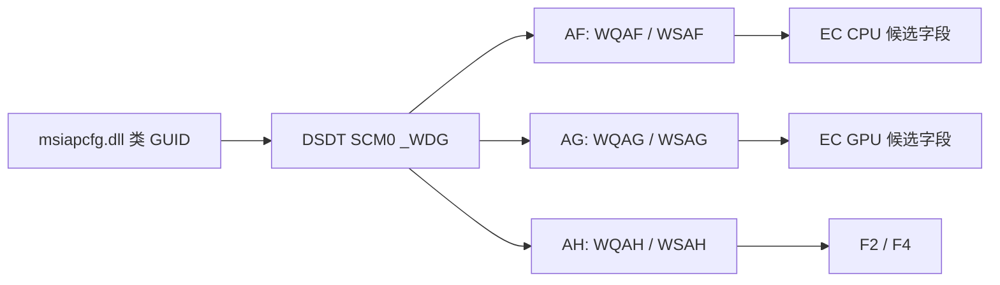

# GS66 10SE：官方 BIOS / EC 离线分析

研究日期：2026-10-11。目标为 MS-16V1 / GS66 Stealth 10SE；**用户实机 BIOS、EC 和已装 WMI provider 版本仍未知**。本次下载的是官方发布样本，没有刷写、运行固件更新器、调用厂商 WMI 方法或读取 EC 实例。Windows 原型保持系统身份查询与 WMI 类定义读取。

## 本轮得到的结论

1. BIOS `E16V1IMS.112` 的 DSDT 内 `SCM0` 是可具体追踪的 legacy WMI 接口。其 GUID 与原厂 `msiapcfg.dll` 中的 `MSI_CPU`、`MSI_VGA`、`MSI_System`、`MSI_AP` 等类一致，补齐了上轮“类名到固件字段”的缺口。[F02–F04]
2. 固件 CPU / GPU 的实例索引 11–16 分别访问 EC `72–77` / `8A–8F`，系统实例索引 7 / 9 访问 `F2` / `F4`。结合上轮原厂六点曲线、Shift、模式代码，得到精确到此 BIOS 的**候选 G1 映射**。原厂代码使用 Windows 枚举序号；它是否等于这些 ACPI 索引仍需实机核对，不能将候选直接变成写入地址表。[F03–F05]
3. `MSI_AP` 对应的 `WQAI(1)` 在返回前执行 `TDCE = TDVR`，其中 `TDCE` 是 EC `CE`、`TDVR=0x14`。**查询方法也可能有写副作用**。本轮没有增加 `SELECT * FROM MSI_AP` 等厂商实例读取；图形界面只展示类定义。[F03]
4. 雕出的 75 张唯一、校验和有效的 DSDT/SSDT 候选中，没有找到 schema 中 `MSI_ACPI` 的 GUID 字节模式。此 BIOS 的 `SCM0` 也未声明该现代方法块。因而不能因为软件 DLL 宣告 `Get_Fan/Set_Data` 就把 WMI2 的 D2/D4/D7 路径套给该 BIOS。这个负面搜索只覆盖所列候选表，不能推广为所有 GS66 固件或运行时系统都没有 WMI2。[F02、F04]

这里的 `[BIN]` 表示直接来自本轮固件/资源字节或反编译结构；`[INF]` 表示跨层推断；`[HW?]` 表示尚待实机验证。静态固件证据不代表实际硬件测量。

## 样本来源与身份

[MSI GS66 10SX 系列支持页](https://www.msi.com/Laptop/GS66-Stealth-10SX/support) 是系列入口。取得的两个 ZIP 内 release notes 均明确列出 GS66 Stealth 10SE 和 MS-16V1；没有仅按文件名猜机型。BIOS ZIP 的 SHA-256 与 [MSI 官方地区支持页](https://es.msi.com/Laptop/GS66-Stealth-10SX/support?sub_product=GS66-Stealth-10SF) 发布值一致，10SE 的适用性另由包内 notes 确认。

| 样本 | 官方来源 | 大小；SHA-256 |
| --- | --- | --- |
| BIOS ZIP | [E16V1IMS.112.zip](https://download.msi.com/bos_exe/nb/E16V1IMS.112.zip) | 7,748,573 bytes；`db2b8cba87eed4f27e8af67fbd919067fdc810e834d0d97acec8bec42b89cd3b` |
| BIOS image | ZIP 内 `E16V1IMS.112/E16V1IMS.112` | 16,777,216 bytes；`81b67146ee0940468e00c33fd3588ae1ef2f061d41f6c0d801350857ff9bd1c8` |
| EC ZIP | [16V1EMS1.118.zip](https://download.msi.com/archive/frm_exe/nb/16V1EMS1.118.zip) | 1,011,780 bytes；`b8520d6fe69bcfe8c83bb63fbc5003fbfbb76191d2f4287dfd1465e499c5172f` |
| EC image | ZIP 内 `16V1EMS1.118/16V1EMS1.118` | 131,072 bytes；`9f4db4407715ec284b6b1ab8396792ffbd3e854d757e6778ba38ac04f4fcf68a` |

两个 ZIP 均通过 CRC 检查。BIOS notes 的发布日期是 2020-12-15，页面日期为 2020-12-18；EC notes 的 `.118` 日期为 2021-03-10，EC image `0x9010` 处包含版本及 `02/04/2116:46:37` 文本。构建文本与发布记录分开保留，未将其当作用户机器版本或解释为已经验证的本地时间。[F01]

两个样本分别取自独立发布包，没有证明它们是某台机器已安装的配对，也不建议为了运行原型更新到这些版本。

EC notes 记录 `.112/.114` 调整 CPU fan table，`.118` 改善电池模式 fan function，`.109` 提到 CPU Tau 56 秒。这些是发布说明，不能证明某性能模式会设置 PL1/PL2，也没有从发布说明恢复电池模式算法或风扇默认值。本轮只完成 EC 样本身份、版本文本和历史变更核对；**尚未完成 EC 控制程序的指令级调用图、银行切换和风扇算法恢复**。[F01]

## BIOS 解包与 WMI 绑定

UEFIExtract A75 解开固件压缩卷。离线脚本扫描 2,458 个 `body.bin`，按 ACPI 头长度和校验和过滤、按内容 SHA-256 去重，得到 1 张 DSDT 和 74 张 SSDT 候选。部分 SSDT 是固件内预置的其他平台/设备模板，不能将候选数量当成运行时安装数量。UEFIExtract 对 Intel descriptor / CSE 分区给出格式警告；相关 CSE 结构不参与本轮 ACPI 结论，不把工具报告解释为整个固件已完整恢复。[F02]

DSDT 为 `MSI_NB / MEGABOOK`，265,893 bytes，SHA-256 `6677339abcebcc88c439a0f7d50ad1d3f7ecce45ad7c9597bd84cfef1f7aed08`。最小对应 section 是 GUID `C118F50D-391D-45F4-B3D3-11BC931AA56D` 的 raw body，偏移 0。完整 section 路径及 SHA 见索引；**解压后 section 偏移不是原始 flash 偏移**。[F02]

iasl 20250404 成功反编译 DSDT。它给出 ESPC / PMBS / PSON / SSMP 外部声明冲突警告；未重新编译或安装该 ASL。关注的 `SCM0` 在 `\_SB.PCI0.LPCB.EC` 下，声明长度 256 的 `EmbeddedControl` region。`Field` 使用 `ByteAcc / NoLock / Preserve`；具体线程并发、固件原子性和失败恢复仍未知。[F03]

原厂 schema 取自与上轮相同哈希的官方 Dragon Center 包，`N syswow64/msiapcfg.dll` SHA-256 为 `d02e23490f28d7636b13d8b2a8a830c00afdc2ba8747cece9ad9a6dd95fe301f`。REA 真实 `inspect_pe_resources` 定位 `MOFDATA / MOFRESOURCE / 1033`，文件范围 2160–5788，payload SHA-256 为 `bf35f4d7f7c82c7953ddc5ce173573044c5821a745f7391e5a133e6a6ee37b14`。用固定提交的 bmfdec 解压后，按 GUID 绑定以下数据块，避免按类名顺序猜测。[F04]

| 对象 ID | MOF 类名；GUID | 声明实例数 | 固件方法 |
| --- | --- | --- | --- |
| AF | MSI_CPU；`BD2A216F-2FB9-A640-B807-DDDBAD656891` | 19 | WQAF / WSAF |
| AG | MSI_VGA；`1EC3EC7A-1E9B-E74A-9026-CF122B0BBD21` | 18 | WQAG / WSAG |
| AH | MSI_System；`A1753D7B-B621-DE4A-B41A-55716A0ECE7A` | 21 | WQAH / WSAH |
| AI | MSI_AP；`A1753D7C-B621-DE4A-B41A-55716A0ECE7A` | 8 | WQAI / WSAI |

其他 AA–AE 是 Software / Device / Power / Master_Battery / Slave_Battery；最后是事件 GUID。所有十条 descriptor 的原始 ID、flags、GUID 及完整方法索引表在 JSON 中。[F03–F04]

原版 `bmf2mof` 在最后的 `MSI_ACPI` 方法参数解析失败。仓库 adapter 使用未修改的 upstream parser，只解析前 15/16 个类，并保留完整解压缓冲区和原始 offset 供 qualifier flavor 定位。它没有跳过校验来伪造完整成功，也没有恢复最后一类的方法签名。保存的 `legacy-classes.mof` 明确注明范围。[F04]

## 新恢复的候选映射

以下索引是固件方法 `Arg0`，**不是已经在 Windows 实机确认的枚举顺序**。WMI provider 的 `InstanceName`、索引稳定性及所装 schema 仍需核对。表内 EC 偏移不等于 WINIO `0xFC0008xx` 的物理映射；本轮没有恢复或实测那个镜像机制。

| 固件对象与索引 | EmbeddedControl 字段/偏移 | 与上轮软件证据结合后的含义 |
| --- | --- | --- |
| CPU 1 / GPU 1 | TD68=`68` / TD80=`80` | 温度候选；单位、异常值未实测 |
| CPU 2 / GPU 2 | TD71=`71` / TD89=`89` | 风扇速度字段候选；不能直接标为 RPM |
| CPU 5–10 / GPU 5–10 | TD6A–TD6F / TD82–TD87 | 六个阈值候选；软件此路径未写它们 |
| CPU 11–16 / GPU 11–16 | TD72–TD77 / TD8A–TD8F | 原厂六个 UI 速度值的候选目的字段 [INF] |
| CPU 17 / GPU 17 | TD78 / TD90 | 相邻额外速度候选；该六点 UI 路径保留其现值，不能猜其安全默认值 |
| System 7 / 9 | TDF2 / TDF4 | Shift / 风扇模式跨层绑定候选 [INF] |
| AP 2 / 3 | TDCD / TDCC | 原厂第一组计数的候选低/高字节 [INF] |
| AP 4 / 5 | TDCB / TDCA | 原厂第二组计数的候选低/高字节 [INF] |
| AP 1 | TDCE；返回前写入 TDVR=`14` | 查询副作用直接可见 [BIN] |

上轮 `GetFanSpeed` 以枚举序号 2/3 和 4/5 形成计数，公式是 `60000000 / (count * 2 * 62.5)`。结合本轮 AP 映射可提出 `CD/CC`、`CB/CA` 两计数候选；没有把 AP 6/7 再推断成第三风扇。第三颗风扇的跟随/PWM/测速关系仍未知。[F03、F05]

System 9 对应 F4 后，legacy 曲线模式置 bit7、清 bit6、自动模式清高两位的代码与 G1 `8D/0D` 更一致；但 F4 其他位和所有状态转换仍需验证。现代 WMI2 模式位处理不同，不能将两代设置代码混用。`WQAI(1)` 中的 `0x14` 是这版 BIOS 内的字面常量，不是一次实测 WMIEC / EC firmware 版本。



## 原型实现与下一步

[Windows 原型说明](windows-app.md) 包含使用与发布方式。图形界面可一键采集系统身份与 BIOS 版本、查看 MSI 类 GUID / 属性 / 方法定义、明确切换模拟来源并导出 JSON。探针查询有取消检查和枚举等待超时，警告只保留异常类型、不导出原始异常消息。取消是协作式；WMI 连接或正在进行的调用不保证立即停止，也不能把 8 秒枚举等待超时说成整个诊断的硬性截止时间。

本轮未实施厂商实例查询、风扇/功耗/电池写入、服务替换或刷写。已有静态映射可指导后续研究，但进入控制阶段仍缺实际 BIOS/EC 版本、实例键到 `Arg0` 的关系、曲线单位/端点、独立恢复路径和第三风扇映射。首先可在 Windows 运行原型导出类定义；完整 EC 版本需从现有厂商信息界面人工核对，当前原型不会为获取它调用有副作用的 AP 查询。

## 证据与复现

| ID | 保存的证据 | 范围 |
| --- | --- | --- |
| F01 | [samples.json](evidence/firmware/samples.json)、[release-notes.json](evidence/firmware/release-notes.json)、REA BIOS/EC package | ZIP/image 身份、适用机型、版本与发布记录 |
| F02 | [acpi-index.json](evidence/firmware/acpi-index.json)、samples 的 GUID 搜索 | 75 张候选、解压 section 来源及受限负面搜索 |
| F03 | [acpi-wmi-map.json](evidence/firmware/acpi-wmi-map.json)、[iasl diagnostics](evidence/firmware/iasl-diagnostics.txt) | GUID、字段位偏移、18 个 query/set 方法映射、逐字 ASL 片段及行号 |
| F04 | [REA PE resources](evidence/firmware/rea-msiapcfg-resources.json)、[legacy MOF](evidence/firmware/legacy-classes.mof) | DLL/resource 哈希与首 15 类 schema |
| F05 | [上轮 managed-exact](evidence/dragon-center/managed-exact.json)：Base Module Adv_Fan/GetFanSpeed、Shift | 六点 UI、模式、枚举序号与 RPM 公式；硬件仍未知 |

本轮采用 `morluto/rea` 的 reverse-engineer-anything skill v37（仓库提交 `d9b4ae182d60dfd7fd5ba5bb539716413cbfdca6`）及真实 `rea-agents@6.4.0` CLI。保存的是工具完整 evidence envelopes，不是手工模拟结果。包与资源操作成功；REA 固件 region 工具因未配置 caller-supplied Binwalk 不可用，错误单独保存。实际 BIOS 解包由 UEFIExtract 完成、AML 反编译由 iasl 完成，不将这些 shell 操作冒充 REA evidence。没有修改 Codex 全局注册配置，也没有为此运行目标固件或 Windows 程序。

固件 ZIP、原厂二进制与完整解包树留在工作区 `/workspace/gs66-firmware-research`，不入 Git。仓库仅保存清单、研究范围的结构/片段、工具 evidence 和脚本。最小复现流程（在研究目录操作，不执行包内 EXE/BAT）：

```bash
uefiextract E16V1IMS.112 all
python scripts/extract-acpi-tables.py /path/to/E16V1IMS.112.dump /path/to/new-acpi
iasl -d /path/to/new-acpi/DSDT-6677339abceb.aml
python scripts/summarize-gs66-acpi.py /path/to/new-acpi/DSDT-6677339abceb.dsl /path/to/new-map.json

# 从 REA 记录的文件 offset 2160 提取 3629 bytes 的 MOFRESOURCE。
# bmfdec 必须使用上述固定提交；adapter 仅读取已解压 BMOF。
bmfdec MOFRESOURCE.bmf MOFRESOURCE.decompressed
cc -I /path/to/bmfdec scripts/bmof-legacy-adapter.c -o /path/to/legacy-adapter
/path/to/legacy-adapter MOFRESOURCE.decompressed > /path/to/legacy-classes.mof

npx -y rea-agents@6.4.0 inspect-artifact /path/to/E16V1IMS.112.zip --format json --full-output
npx -y rea-agents@6.4.0 inspect-pe-resources /path/to/msiapcfg.dll --format json --full-output
python -m unittest discover -s tests -p 'test_*.py'
```

摘要脚本有意只支持研究的 `SCM0` 格式，遇到缺失/无法解析字段会失败，不适合作为通用 ACPI 解析器或固件白名单生成器。仓库中 `acpi-wmi-map.json` 额外按确切 GUID 关联 MOF 类名，并记录该关联前的 standalone 输出哈希；复现先验证 standalone hash，再核对已保存 MOF。Windows 构建任务已加入 CI，但本轮环境只有 Linux：交叉编译成功与离线验证通过不能替代 Windows runner、UI 和 GS66 实机测试。

本轮本地验证：CLI 与桌面 App Release 构建均为 0 warnings / 0 errors；Core 单元测试 2/2、生成 ACPI fixture 的解析测试 2/2 通过。9 组 query/set 索引映射互相一致；所有证据 JSON 可解析，十段 ASL 片段逐字内容、原始行号及源 DSL SHA-256 核对成功。完整 Windows ZIP 的 CRC、SHA-256 及所含 DLL 与发布目录一致。未执行 Windows runner 或任何 GS66 硬件测试。
